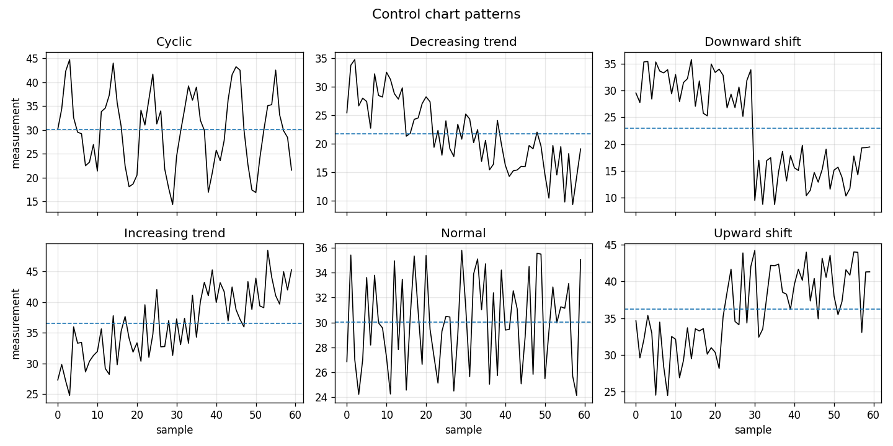
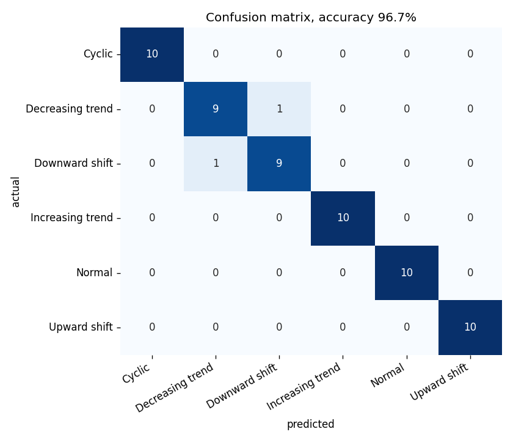
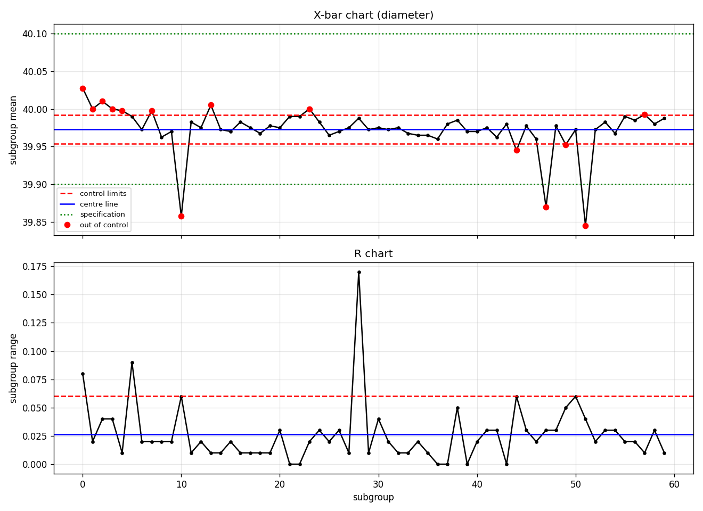

# ControlCharts-PatternRecognition

Classifies control chart patterns that signal an out-of-control industrial process.

[](https://github.com/kaRpuri/ControlCharts-PatternRecognition/actions/workflows/ci.yml)
[](https://www.python.org/)
[](LICENSE)

Built during my automation internship at Dalip Manufacturers, for predictive
maintenance on a production line. An operator watching an X-bar chart has to
spot a drift or a shift by eye, usually after the parts are already out of
tolerance. This classifies the shape of the chart instead, so a trend can be
called while the parts are still good.

## The patterns

Six classes, the standard set used in statistical process control. Only
`Normal` is a process behaving as intended. The other five each point at a
different physical cause: a trend usually means tool wear, a shift means
something changed at a point in time such as a new batch or a fixture reset,
and a cycle means something periodic such as temperature or an operator
rotation.



## Method

Each series is 60 consecutive measurements. Before classification it is
divided by its own largest absolute value:

$$
\tilde{x}_i = \frac{x_i}{\max_j \lvert x_j \rvert}
$$

That removes the absolute level and leaves the shape. It is why a model
trained on synthetic data centred near 30 can score a real process running at
40.0 mm or 22.0 mm without rescaling, and `tests/test_preprocess.py` checks
that property directly.

The classifier is a small fully connected network, 6,279 parameters:

| layer | units | activation |
|---|---|---|
| Dense | 60 | linear |
| Dropout | rate 0.2 | |
| Dense | 39 | ReLU |
| Dropout | rate 0.0 | |
| Dense | 6 | softmax |

Trained with Adam on categorical cross-entropy, batch size 32, up to 60
epochs, with early stopping on validation loss. The second dropout has a rate
of zero and is a no-op. It is kept so the layer count still matches the model
originally trained, which is preserved at `models/control_charts_original.h5`.

### Control chart statistics

`predict` does more than classify. It builds the X-bar and R charts from the
raw measurements and checks the process against its drawing tolerance. For
subgroups of size `n`, with grand mean $\bar{\bar{x}}$ and mean range
$\bar{R}$:

$$
\mathrm{UCL}_{\bar{x}} = \bar{\bar{x}} + A_2 \bar{R},
\qquad
\mathrm{LCL}_{\bar{x}} = \bar{\bar{x}} - A_2 \bar{R},
\qquad
\mathrm{UCL}_R = D_4 \bar{R}
$$

Process sigma is estimated from the mean range, and capability follows:

$$
\hat{\sigma} = \frac{\bar{R}}{d_2},
\qquad
C_p = \frac{\mathrm{USL} - \mathrm{LSL}}{6 \hat{\sigma}},
\qquad
C_{pk} = \frac{\min(\mathrm{USL} - \bar{\bar{x}},\\ \bar{\bar{x}} - \mathrm{LSL})}{3 \hat{\sigma}}
$$

$A_2$, $D_3$, $D_4$ and $d_2$ are the standard Shewhart constants, tabulated
in `spc.py` for subgroup sizes 2 to 10. For `n` below 7 the $D_3$ constant is
zero, so the R chart has no lower control limit.

## Results

### Classification

Trained on the 600 series in `data/synthetic_control.csv`, split 540 train and
60 test, stratified, seed 101. Early stopping did not trigger, so all 60
epochs ran.

| | accuracy |
|---|---|
| training | 96.85% |
| test | **96.67%** |

58 of 60 test series correct. Per class, on 10 test series each:

| class | precision | recall | f1 |
|---|---|---|---|
| Cyclic | 1.000 | 1.000 | 1.000 |
| Decreasing trend | 0.900 | 0.900 | 0.900 |
| Downward shift | 0.900 | 0.900 | 0.900 |
| Increasing trend | 1.000 | 1.000 | 1.000 |
| Normal | 1.000 | 1.000 | 1.000 |
| Upward shift | 1.000 | 1.000 | 1.000 |



Both errors are between `Decreasing trend` and `Downward shift`, which is the
expected confusion. A gradual downward drift and a step down look similar over
60 points once the step lands early in the window.

The original notebook reported 88.33% validation accuracy, stopping at epoch
42 of 60. That number is not directly comparable and cannot be reproduced: the
notebook shuffled with `ccdf.sample(frac=1)` and no `random_state`, so its
split is unrecoverable. The split here is also stratified and restores the
best weights, neither of which the notebook did.

Reproduce with:

```bash
controlcharts train
controlcharts evaluate
```

### On the production line data

Two characteristics measured on the line, 60 subgroups of 4, against their
drawing tolerance.

| | diameter | width |
|---|---|---|
| nominal | 40.0 mm | 22.0 mm |
| tolerance | 39.9 to 40.1 | 21.9 to 22.1 |
| grand mean | 39.9727 mm | 21.9973 mm |
| mean range | 0.0263 mm | 0.0530 mm |
| Cp | 2.606 | 1.295 |
| Cpk | 1.894 | 1.259 |
| X-bar pattern | Normal (99.9%) | Normal (99.9%) |
| R pattern | Cyclic (70.1%) | Cyclic (92.9%) |
| findings | 17 | 7 |



Both characteristics are capable, Cpk above 1.33 for diameter and above 1.0
for width, so the parts meet the drawing. Neither is in statistical control:
14 of 60 diameter subgroup means fall outside the control limits, visible as
the red points well inside the green specification lines. Capable but not
controlled is a real and common state, and it is what the control limits are
for. The specification says whether today's parts pass. The control limits say
whether the process is steady enough to keep passing.

Reproduce with:

```bash
controlcharts predict data/diameter_real_process.csv --spec diameter --plot assets/diameter_control_chart.png
```

## Corrections to the original notebooks

The logic came from two notebooks, now removed. Four defects were found while
porting. Each is corrected, commented at the point it occurs in `spc.py`, and
pinned by a test in `tests/test_spc.py`.

1. **Only two subgroups were ever checked.** Every rule scan read
   `for val in (0, len(xbar) - 1)`, which iterates a two element tuple rather
   than a range. A spike anywhere between the first and last subgroup was
   invisible. The local name `range` shadowed the builtin, which is what
   forced that workaround. On the diameter data the corrected scan finds 17
   findings where the original found 2.
2. **Cpk was not an index.** It was `min(USL - mean, mean - LSL)`, a distance
   in millimetres with no division by three sigma, so `if Cpk < 0` compared a
   raw distance against zero. On the diameter data the original expression
   gives 0.0727; the corrected Cpk is 1.894.
3. **Cp used the wrong spread.** It divided the specification width by the
   control limit width. Control limits describe the spread of subgroup means,
   not of individual parts, so Cp came out roughly double. On the diameter
   data the original gives 5.209 against a corrected 2.606.
4. **A range of zero was flagged as out of control.** The lower R limit test
   ran unconditionally, and with $D_3 = 0$ for subgroups below size 7 every
   subgroup whose four measurements happened to be identical was reported.

The classification path itself is unchanged. Loading the original weights and
running the ported pipeline reproduces the notebook's recorded output: the
grand mean and mean range match to the last digit printed, and the predicted
probabilities match to 1.2e-7, which is float32 inference noise across
TensorFlow versions.

## Install

```bash
git clone https://github.com/kaRpuri/ControlCharts-PatternRecognition.git
cd ControlCharts-PatternRecognition
pip install -e ".[dev]"
```

Python 3.10 or 3.11. TensorFlow is a large download. With [uv](https://docs.astral.sh/uv/):

```bash
uv venv && uv pip install -e ".[dev]"
```

## Usage

Generate a synthetic dataset:

```bash
controlcharts generate --output data/generated.csv --samples-per-class 100 --seed 0
```

Train, writing the model and the training figures:

```bash
controlcharts train
```

Score the saved model and write the confusion matrix:

```bash
controlcharts evaluate
```

Classify a CSV of process measurements. Pass a named specification from the
config, or give the limits directly:

```bash
controlcharts predict data/width_real_process.csv --spec width
controlcharts predict data/width_real_process.csv --usl 22.1 --lsl 21.9
```

Every command prints a JSON summary. `predict` reports the chart statistics,
Cp and Cpk, the pattern and confidence for both charts, and every finding:

```json
{
  "center_x": 21.99725,
  "patterns": {
    "x-bar": { "pattern": "Normal", "confidence": 0.9995 },
    "range": { "pattern": "Cyclic", "confidence": 0.9286 }
  },
  "in_control": false,
  "cp": 1.295,
  "cpk": 1.2594
}
```

Run `controlcharts <command> --help` for the full option list.

## Configuration

`configs/default.yaml`. Unknown keys are rejected rather than ignored.

```yaml
training:
  epochs: 60
  batch_size: 32
  test_size: 0.10
  seed: 101
  early_stopping_patience: 3

paths:
  dataset: data/synthetic_control.csv
  model: models/control_charts.keras
  assets: assets

specifications:
  diameter:
    usl: 40.1
    lsl: 39.9
```

`seed` fixes the split, the weight initialization and the shuffling, so a run
is reproducible. Add a characteristic under `specifications` to use it with
`predict --spec`.

## Repository structure

```
ControlCharts-PatternRecognition/
├── src/controlcharts/
│   ├── data.py          the six classes, loading and generating series
│   ├── preprocess.py    per-series normalization and the stratified split
│   ├── model.py         the network, as built in the original notebook
│   ├── train.py         seeded training with early stopping
│   ├── evaluate.py      accuracy, per-class report, confusion matrix
│   ├── predict.py       classify a CSV of process measurements
│   ├── spc.py           X-bar and R charts, capability, rule checks
│   ├── plots.py         figures
│   ├── config.py        YAML into dataclasses
│   └── cli.py           generate, train, evaluate, predict
├── configs/default.yaml
├── data/                the public dataset and two sample measurement files
├── models/              the trained model, and the original for reference
├── notebooks/demo.ipynb a walkthrough that only imports from the package
├── assets/              figures, all generated from real runs
└── tests/               pytest suite
```

## Testing

```bash
ruff check .
ruff format --check .
pytest
```

87 tests covering the dataset and its label order, normalization, the network
architecture and a forward pass, the chart statistics including all four
corrections above, prediction on a small CSV, and an end to end pass through
the CLI that generates data, trains one epoch, evaluates and predicts. CI runs
all three on Python 3.10 and 3.11.

## Data

`data/synthetic_control.csv` is the Synthetic Control Chart Time Series data
set from the UCI Machine Learning Repository, 600 series of 60 points, 100 per
class, created by Robert Alcock and Yannis Manolopoulos. It is available at
<https://archive.ics.uci.edu/dataset/139/synthetic+control+chart+time+series>.

`data/diameter_real_process.csv` and `data/width_real_process.csv` are sample
dimensional measurements taken on the production line during the internship,
240 readings each. They carry no part, customer or date information.

## Acknowledgments

Dalip Manufacturers, for the internship and for access to the line data. The
pattern definitions and the Shewhart constants follow standard SPC practice,
as set out in Montgomery, *Introduction to Statistical Quality Control*.

## License

MIT, see [LICENSE](LICENSE).
